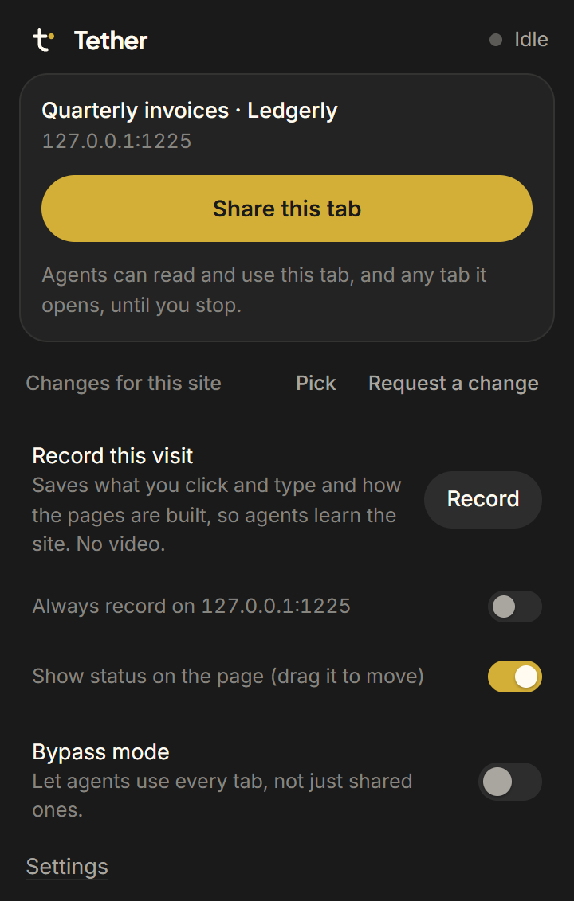
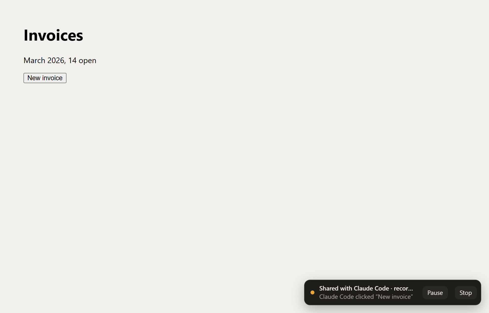

# Tether

Tether lets Claude Code, Codex or any other MCP client work in the browser you already use, signed in as you, on the tabs you hand it. Click the toolbar button on a tab, choose **Share this tab**, and your agent can read the page, fill forms, click through flows and watch network traffic.

It can also change sites for you. Send a request from the popup with a few words and a screenshot or mockup, and the agent restyles the site or writes a script for it. Styles and scripts are saved as ordinary UserCSS and userscript files, so they also work in Stylus and Tampermonkey. Turn on recording for a site and Tether keeps a log of how you use it (what you click, what you fill in, which pages and APIs are involved), which agents read later to understand the site before they touch it.

It works in Chrome, Brave, Edge and other Chromium browsers, and in Firefox. Several browsers and several agents can be connected at once.

<p>
  
  
</p>

## How it works

```
Claude Code ─┐                               ┌─ Chrome extension ── shared tabs
Codex ───────┼─ tether (stdio) ─ HTTP ─ host ┤
other MCP ───┘          127.0.0.1:47821      └─ Firefox extension ── shared tabs
```

Each agent launches `tether` as an ordinary stdio MCP server. The first one starts a small host process in the background, and every later one connects to the same host, so all agents see the same browsers. Once paired, the extension keeps a local WebSocket open to the host whenever the host is running, so an agent can ask to start a session. You can turn that off in settings, and then it only connects while something is shared or recorded. The host quits by itself after 30 minutes with nothing connected.

Nothing happens on a tab you haven't shared. The agent can't list it, read it or touch it. A shared tab gets an amber badge on the toolbar button and a small pill in the corner of the page that names the agent, shows its latest action and has a Stop button.



Tabs join the session in these ways:

1. You click **Share this tab**.
2. The agent calls `start_session` and you click **Open window** or **Share tab** in the prompt (see below).
3. A shared page opens a new tab or window (a `target="_blank"` link, `window.open`). Tabs you open yourself with Ctrl+T don't count.
4. The agent opens one with `open_tab`, or any tab is opened inside the agent's own window.

## Agent sessions

An agent doesn't have to wait for you to click. When it needs the browser it calls `start_session`, and a small prompt asks you first:

- **Its own window** (the default). Tether opens a new window in your browser, signed in as you, and the agent works only in that window's tabs. Your own tabs and windows stay private and keep working. The agent closes the window with `end_session`, or you close it.
- **The tab you're on** (`mode: "current"`). For tasks about the page in front of you. It's the same as clicking Share this tab yourself.

Settings has a switch to skip the prompt for the agent's own window, and one to turn session requests off.

## The skill

`skills/tether-browser/SKILL.md` teaches Claude Code, Codex and other agents to use Tether for browser work instead of Playwright: how to start a session, the snapshot-and-ref loop, debugging, restyling, scripts, reading recordings, and when to ask before acting. Link it into each agent's skills folder so it stays in sync with the repo:

```powershell
foreach ($d in "$env:USERPROFILE\.claude\skills", "$env:USERPROFILE\.codex\skills", "$env:USERPROFILE\.agents\skills") {
  New-Item -ItemType Junction -Path "$d\tether-browser" -Target "E:\Projects\tether\skills\tether-browser"
}
```

On macOS or Linux, `ln -s "$PWD/skills/tether-browser" ~/.claude/skills/` and the same for the other folders.

## Setup

You need Node 20 or newer.

```sh
git clone https://github.com/udaysinh-git/tether.git
cd tether
npm install
npm run build
node host/cli.js setup
```

`setup` prints the exact lines for your machine, including the pairing key. On this machine they look like:

```sh
# Claude Code
claude mcp add --scope user tether -- "C:\Program Files\nodejs\node.exe" E:\Projects\tether\host\cli.js
```

```toml
# Codex: ~/.codex/config.toml
[mcp_servers.tether]
command = "C:\\Program Files\\nodejs\\node.exe"
args = ["E:\\Projects\\tether\\host\\cli.js"]
```

Any other MCP client takes the same command as a stdio server.

### Chrome, Brave, Edge

1. Open `chrome://extensions` (or `brave://extensions`, `edge://extensions`) and turn on Developer mode.
2. Click **Load unpacked** and choose `dist/chrome`.
3. Pin Tether to the toolbar, click it, and paste the pairing key.
4. Optional: on the extension's Details page, turn on **Allow user scripts** so scripts marked `auto` run on every visit.

### Firefox

This covers Firefox and browsers built on it, such as Zen, LibreWolf, Floorp and Waterfox.

1. Make sure `node host/cli.js setup` (or `node host/cli.js install-native`) has run. It registers a small bridge the browser starts through native messaging. Firefox upgrades an MV3 extension's `ws://127.0.0.1` connection to `wss://`, which can't reach the host, so Firefox talks to the bridge instead. The bridge starts the host if it isn't running and supplies the pairing key, so there's nothing to paste.
2. Open `about:debugging#/runtime/this-firefox`, click **Load Temporary Add-on** and pick `dist/firefox/manifest.json`.
3. The first time you share a tab, Firefox asks for access to all sites; allow it.
4. Optional: in Tether's settings, click **Allow user scripts**.

Temporary add-ons are removed when Firefox closes. To keep it installed, sign it as an unlisted add-on with `npx web-ext sign -s dist/firefox --channel unlisted` (needs an addons.mozilla.org API key), or use Firefox Developer Edition with `xpinstall.signatures.required` set to `false`.

## What the agent can do

| Tool | What it does |
| --- | --- |
| `list_tabs` | Lists the tabs it may use, with handles like `chrome:812` |
| `start_session`, `end_session` | Asks for its own window or your current tab; closes the window or gives the tab back |
| `snapshot` | Reads the page as an outline of headings, text and controls, each control with a ref like `[e14]` |
| `read_text` | Plain visible text of the page or one element |
| `click`, `hover` | Clicks or hovers an element by ref |
| `type`, `fill_form`, `select_option` | Types into fields, fills several at once (text, checkboxes, radios, selects) |
| `press_key`, `scroll`, `wait_for` | Keys like `Enter` or `Control+a`, scrolling, waiting for text to appear or go away |
| `upload_file` | Attaches files from disk to a file input, including hidden ones |
| `navigate`, `open_tab`, `close_tab` | Moves around and manages tabs |
| `screenshot` | Image of the visible part of a tab |
| `run_js` | Runs JavaScript in the page's own context and returns the result |
| `network_requests`, `network_request` | The network log since the tab was shared, then full headers and bodies for one request |
| `console_messages` | Console output and uncaught errors |
| `cookies` | Cookies for the current page, including httpOnly ones |
| `get_requests`, `resolve_request` | Change requests you sent from the popup, with their images; a reply you see in the popup |
| `apply_css`, `clear_preview` | Tries CSS on a tab without saving it |
| `save_style`, `get_style`, `list_styles`, `delete_style` | Site styles, saved as UserCSS |
| `save_script`, `get_script`, `run_script`, `list_scripts`, `delete_script` | Userscripts, saved in Tampermonkey's format |
| `install_userscript` | Installs a `.user.js` or `.user.css` from a URL or pasted text |
| `site_list`, `site_map`, `site_sessions`, `site_notes` | What Tether recorded about how you use a site, and notes agents keep about it |
| `request_bypass` | Asks you for access to every tab (see below) |

Every action returns a fresh snapshot, so the agent rarely needs a second call to see what changed.

## Bypass mode

By default the agent only gets shared tabs. When a task needs more, for example comparing prices across tabs you already have open, the agent calls `request_bypass` with a reason. A small window opens in the browser with the agent's name and that reason, and nothing changes until you click **Allow**.


You can also flip the switch in the popup yourself. While bypass is on, `list_tabs` shows every tab, and any tab the agent touches gets the badge and pill like a shared one. Bypass turns off when you switch it off, click **Stop everything**, or close the browser.

## Changing how a site looks and works

Click **Request a change** in the popup, write what you want, and paste, drop or attach images: a screenshot of a site you like, a mockup, a photo of a sketch. Sending it shares the tab. Then tell your agent to check Tether's requests. It reads the text and images with `get_requests`, tries CSS on the live tab with `apply_css`, checks the result with `screenshot`, and saves it with `save_style`. When the look needs more than CSS (moving elements, adding a button, hiding things that load late) it adds a script. It finishes with `resolve_request`, and its reply shows under the request in the popup.


Saved styles apply on every visit to matching pages, in every connected browser. Each one has a switch in the popup and on the settings page.

### Scripts

Ask for something you'll repeat ("make me a script that fills this timesheet with my usual hours") and the agent saves it with `save_script`. Manual scripts get a **Run** button in the popup on matching pages. Automatic ones run on every page load once user scripts are allowed (see Setup), and each has its own switch.

### Files that work elsewhere

Scripts and styles are kept in the formats other managers use, one file each:

```
~/.tether/scripts/fill-timesheet.user.js    userscript: Tampermonkey, Violentmonkey
~/.tether/styles/calm-ledgerly.user.css     UserCSS: Stylus
```

```js
// ==UserScript==
// @name         Fill timesheet
// @namespace    tether
// @version      1.0.2
// @description  Fills this week with 9:30 to 18:00
// @match        https://erp.example.com/timesheet*
// @grant        GM_registerMenuCommand
// @run-at       document-idle
// @tether-run   manual
// ==/UserScript==
(function () {
  // Manual: a menu command in Tampermonkey and Violentmonkey, the Run button in Tether.
  const run = function () {
    // tether:body start
    document.querySelectorAll("input.start").forEach((el) => (el.value = "09:30"));
    document.querySelectorAll("input.end").forEach((el) => (el.value = "18:00"));
    return "filled";
    // tether:body end
  };
  return typeof GM_registerMenuCommand === "function" ? GM_registerMenuCommand("Fill timesheet", run) : run();
})();
```

Download any of them from Tether's settings page and drop the file into Tampermonkey or Stylus, or send it to someone. Manual scripts become a menu command there instead of running on load. Every save bumps `@version`, so those managers notice updates.

It works the other way too. **Install** on the settings page, or the agent's `install_userscript`, takes `.user.js` and `.user.css` files from Greasy Fork, OpenUserJS, userstyles.world or anywhere else and keeps them unchanged. Tether supports `@match`, `@include`, `@exclude`, `@exclude-match` and `@run-at`, plus these `GM_` functions: `GM_addStyle`, `GM_getValue`, `GM_setValue`, `GM_deleteValue`, `GM_listValues`, `GM_xmlhttpRequest`, `GM_openInTab`, `GM_setClipboard`, `GM_notification`, `GM_registerMenuCommand`, the `GM.*` promise versions and `unsafeWindow`. UserCSS `@-moz-document` sections (`url`, `url-prefix`, `domain`, `regexp`) are matched the way Stylus matches them.

Edit or delete the files directly and every connected browser picks up the change.

## Recording how you use a site

Click **Record** in the popup to record the current visit, or turn on **Always record on** a site to record every visit there. A coral dot in the page corner shows a recording is running. Tether records interactions and structure, not video:

- each click, with the element's role, name, a CSS selector that finds it again, where it sits on the page and the section it's in
- what you type and choose in fields, form submits, and Enter, Escape and shortcut keys
- every page you open (single-page apps included) and the outline of each page as it changes
- the site's own API calls: method, URL, status and time

Passwords, card numbers, one-time codes and fields that look like them are always masked. You can stop recording typed text altogether in settings. Events are saved under `~/.tether/sites/<host>/` once the host is running, and the extension holds them until then.

Agents read it back with `site_map`, which folds every session into one summary: the site's pages, the buttons and links you actually use on each, the fields you fill, the APIs behind them and the usual paths between pages. `site_map` with a page path gives that page's full outline, and `site_sessions` replays a session step by step. Agents can write what they learn into `site_notes`, which shows at the top of the map next time.

## Permissions, and why

The extension asks for broad permissions so pages can't stop the agent from doing what you asked. They only apply to tabs you've shared, or every tab while bypass is on.

| Permission | Used for |
| --- | --- |
| Access to all sites | Reading and acting on whatever site you share |
| `debugger` (Chromium) | Clicks and keystrokes the page can't tell apart from yours, `run_js` past strict Content Security Policies, network capture with response bodies, console capture |
| `webRequest` | Network log; in Firefox also response bodies for fetch/XHR, and removing CSP headers on shared tabs so `run_js` works there |
| `scripting`, `userScripts` | The page outline and actions; saved scripts |
| `cookies` | The `cookies` tool |
| `tabs`, `webNavigation`, `storage`, `alarms` | Tracking shared tabs and the tabs they open; reconnecting after the browser puts the extension to sleep |

While the debugger is attached, Chromium shows a "Tether started debugging this browser" bar. That bar is the browser's own notice and the extension can't hide it. If you click Cancel on it, Tether stops using the debugger for that tab and falls back to ordinary DOM events. You can also turn it off for good under **Real input** in Tether's settings.

Firefox has no debugger API, so there clicks and typing are DOM events. Most sites accept them; a few that check `event.isTrusted` won't. For `run_js` on a strict-CSP page in Firefox, reload the tab once after sharing it.

## What sites can see

Tether keeps a small footprint in the page. The pill lives in a closed shadow root, the outline code runs in the extension's isolated world, and nothing is added to the page's own JavaScript globals unless you or the agent run a script there. With real input on, clicks and keys look the same to the page as yours.

Tether doesn't spoof fingerprints or try to defeat bot detection. Agent-paced browsing can still look automated to sites that watch behaviour, and some sites' terms forbid automation. That's between you and the site.

## Security

- The host listens on `127.0.0.1` only. It refuses HTTP requests that carry an `Origin` header or the wrong `Host`, so web pages can't reach it, even through DNS rebinding.
- Agents and the extension both need the pairing key in `~/.tether/config.json`. `tether key --new` makes a new one; paste it into the extension again afterwards.
- The host only accepts WebSocket connections from browser-extension origins, and the extension never takes commands from web pages.
- Anyone who can run programs as your user can read the key and drive shared tabs. Treat sharing a tab like handing someone your mouse.

Agents are told to ask before paying, sending messages or deleting things, but that's an instruction to the model, not something Tether enforces. Watch the pill when it matters.

## Commands

```sh
node host/cli.js            # stdio MCP server (what agents run)
node host/cli.js serve      # host in the foreground with logs
node host/cli.js status     # browsers, agents and tab count
node host/cli.js key        # print the pairing key
node host/cli.js key --new  # rotate it
node host/cli.js setup      # config lines for Claude Code and Codex
```

`npm link` puts `tether` on your PATH if you'd rather type that. Host logs go to `~/.tether/host.log` when an agent starts it.

## Development

```
host/        MCP host: cli.js, shim.js (stdio bridge), daemon.js (HTTP + WebSocket), hub.js, tools.js,
             scripts.js (userscript + UserCSS files), sites.js (recordings, site map), requests.js
extension/   background.js, content.js (outline, actions, pill), popup/, options/, prompt/ (bypass window)
scripts/     build-ext.js writes dist/chrome and dist/firefox; make-icons.js draws the icons
test/        e2e.mjs (Chromium + extension + MCP client), shots.mjs (UI screenshots)
```

```sh
npm run build   # after any change in extension/
npm test        # end-to-end, once with the debugger and once without
npm run shots   # screenshots of the popup, pill, prompt and settings into test/shots
```

The end-to-end test loads the built extension into Playwright's Chromium, serves a test page, connects an MCP client through the stdio shim and checks sharing, the outline, form filling, trusted clicks, network and console capture, saved and imported userscripts, CSS previews and saved styles, recording and the site map, change requests with images, agent windows and current-tab sessions, bypass and stopping. `--fallback` runs it again without the debugger, which is the same code path Firefox uses. Firefox itself is checked with `npx web-ext lint -s dist/firefox`, not driven end to end.

## Known limits

- Cross-origin iframes show up in the outline as a line you can't read into. Same-origin frames are read and clicked normally.
- Canvas apps (Figma, Google Sheets' grid, games) have little in the outline to act on. Use `screenshot` and `run_js`.
- Network and console logs start when a tab is shared and keep the last 400 entries per tab.
- Screenshots without the debugger, including all Firefox screenshots, bring the tab to the front first.
- Imported userscripts: `@require` and `@resource` aren't loaded. `GM_xmlhttpRequest` uses the page's `fetch`, so cross-site calls are subject to CORS, unlike in Tampermonkey. `GM_setValue` stores values in the site's localStorage, so a script's values aren't shared across sites.
- Imported UserCSS that uses `@var` settings or a preprocessor (Stylus, Less) isn't supported.
- The `.user.js` and `.user.css` formats follow what Tampermonkey and Stylus document. The tests check Tether's side; installing into those extensions hasn't been tested yet.
- An agent only sees a change request when it calls `get_requests`, so tell yours to check after you send one.
