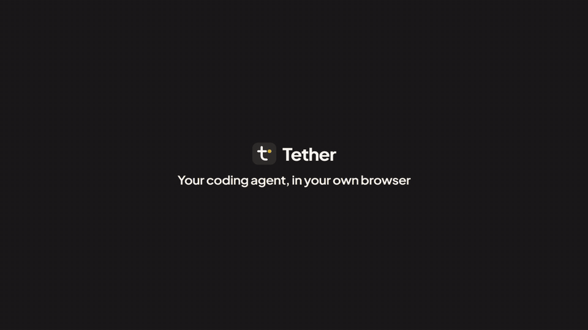
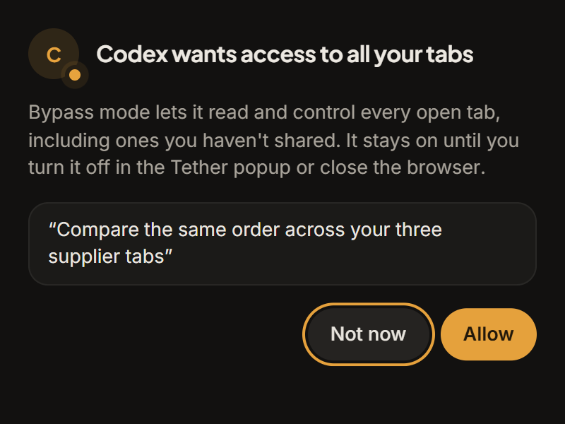
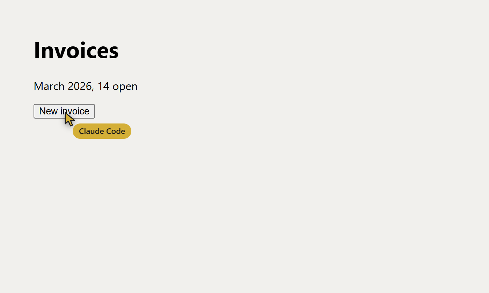
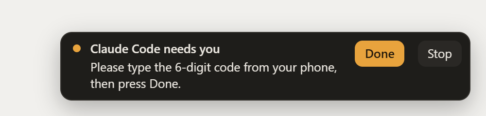
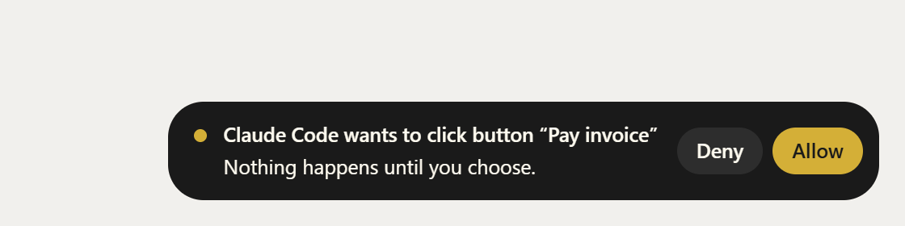
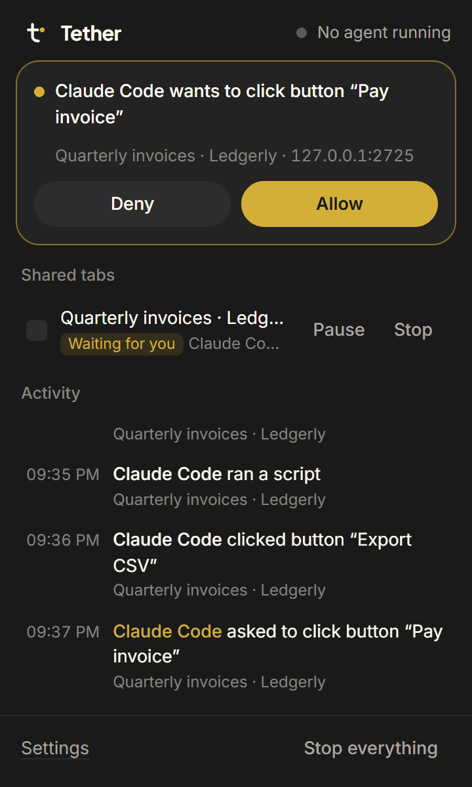
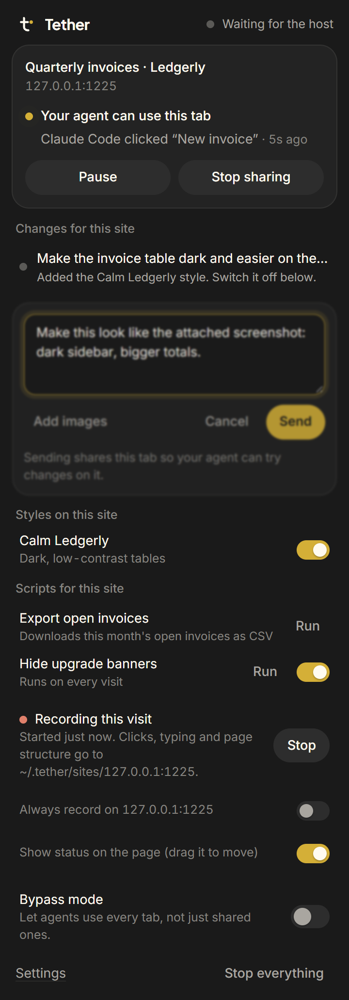
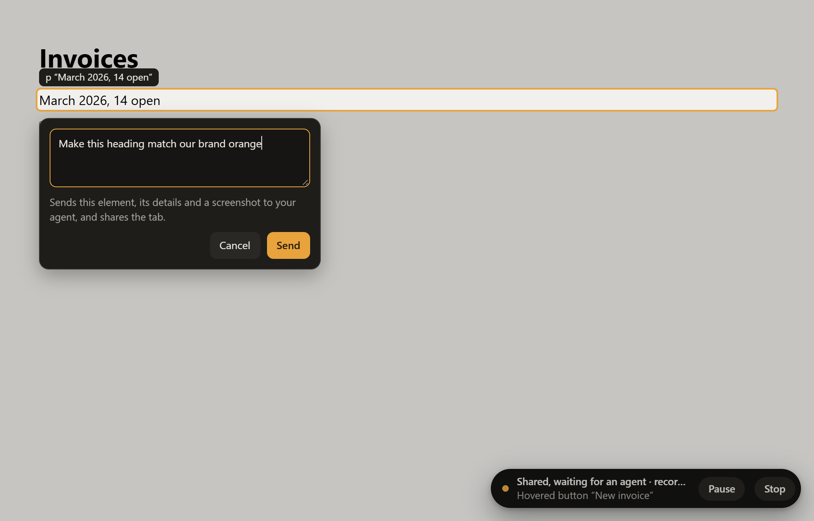

<p align="center"></p>

<h1 align="center">Tether</h1>

<p align="center">
  <a href="https://chromewebstore.google.com/detail/tether/bdkhlojbkkldeehiolelnmnpaanjdncc"></a>
  &nbsp;
  <a href="https://addons.mozilla.org/firefox/addon/tether/"></a>
</p>

<p align="center">
  <a href="https://chromewebstore.google.com/detail/tether/bdkhlojbkkldeehiolelnmnpaanjdncc"></a>
  <a href="https://addons.mozilla.org/firefox/addon/tether/"></a>
  <a href="https://www.npmjs.com/package/tether-browser"></a>
  <a href="https://www.npmjs.com/package/tether-browser"></a>
  <a href="https://registry.modelcontextprotocol.io/v0/servers?search=io.github.udaysinh-git/tether"></a>
  <br />
  <a href="https://github.com/udaysinh-git/tether/releases/latest"></a>
  <a href="LICENSE"></a>
  <a href="https://www.npmjs.com/package/tether-browser"></a>
  <a href="https://github.com/udaysinh-git/tether#development"></a>
</p>

<p align="center"><a href="https://glama.ai/mcp/servers/udaysinh-git/tether"></a></p>

<p align="center"><a href="https://tether.udaysinh.me">Website</a> · <a href="https://tether.udaysinh.me/guide/">Guide</a> · <a href="https://discord.gg/UcB8z8u4JP">Discord</a></p>

<p align="center"><a href="https://tether.udaysinh.me/#watch"></a></p>

Tether lets Claude Code, Codex or any other MCP client use the browser you already use, signed in as you. You choose which tabs it gets. From there the agent can read pages, fill and submit forms, click through flows, read the network log and console, save files and media, and change how a site looks or behaves.

A browser extension (Chrome, Brave, Edge and other Chromium browsers; Firefox, Zen and other Firefox forks) talks to a small local host, and every MCP agent on the machine connects to that host. Nothing on a tab is visible to an agent until you share it or approve the agent's request.

<p>
  
  
</p>

Ideas, feedback and early builds live in the #tether channel of [the KuroLabs Discord](https://discord.gg/UcB8z8u4JP). The most requested ideas get built first.

## Contents

- [Quick start](#quick-start)
- [How it works](#how-it-works)
- [Using it](#using-it)
- [Changing sites](#changing-sites)
- [Recording and site knowledge](#recording-and-site-knowledge)
- [Watchers](#watchers)
- [Tools](#tools)
- [Settings](#settings)
- [Permissions, security and privacy](#permissions-security-and-privacy)
- [Command line](#command-line)
- [Files Tether keeps](#files-tether-keeps)
- [Development](#development)
- [Known limits](#known-limits)
- [Contributing](#contributing)
- [Licence](#licence)

## Quick start

You need Node 20 or newer.

```sh
npm install -g tether-browser
tether setup
```

`setup` prints the lines that add Tether to your agents, prints your pairing key, and registers the bridge Firefox-based browsers use. Then:

1. Add Tether to your agent with the line `setup` prints. It uses full paths, which works everywhere, including Windows. For Claude Code it looks like:

   ```sh
   claude mcp add --scope user tether -- node /path/to/node_modules/tether-browser/host/cli.js
   ```

   Codex, in `~/.codex/config.toml` (single quotes, so Windows backslashes stay literal):

   ```toml
   [mcp_servers.tether]
   command = 'node'
   args = ['/path/to/node_modules/tether-browser/host/cli.js']
   ```

   Any other MCP client runs the same command as a stdio server.

2. Install the extension from your browser's store:

   - Chrome, Brave, Edge and other Chromium browsers: [Tether on the Chrome Web Store](https://chromewebstore.google.com/detail/tether/bdkhlojbkkldeehiolelnmnpaanjdncc). Click **Add to Chrome**, then click the Tether icon and paste the pairing key.
   - Firefox, Zen, LibreWolf, Floorp or Waterfox: [Tether on Firefox Add-ons](https://addons.mozilla.org/firefox/addon/tether/). Click **Add to Firefox**. No key is needed; the bridge supplies it.

   The stores update Tether by themselves, though a new version can take a few days to clear their review. To get it sooner, the [latest release](https://github.com/udaysinh-git/tether/releases/latest) has the same builds: open `tether-firefox-<version>.xpi` in a Firefox-based browser (it's signed by Mozilla), or unzip `tether-chrome-<version>.zip`, turn on Developer mode in `chrome://extensions`, click **Load unpacked** and pick the folder.

3. Install the skill so agents know when and how to use Tether (see [The skill](#the-skill)).

4. Check everything with `tether doctor`.

Open a page, click the Tether icon and choose **Share this tab**, or just ask your agent to do something in the browser and approve its request.

### From source

```sh
git clone https://github.com/udaysinh-git/tether.git
cd tether
npm install
npm run build
node host/cli.js setup
```

Then load `dist/chrome` as an unpacked extension, or in Firefox open `about:debugging`, **This Firefox**, **Load Temporary Add-on** and pick `dist/firefox/manifest.json`.

## How it works

```
Claude Code ─┐                               ┌─ Chrome extension ──── shared tabs
Codex ───────┼─ tether (stdio) ─ HTTP ─ host ┤
other MCP ───┘          127.0.0.1:47821      └─ Firefox bridge ─ Firefox extension ── shared tabs
```

Each agent starts `tether` as an ordinary stdio MCP server. The first one starts the host in the background and later ones join it, so every agent sees the same browsers. Chromium extensions connect to the host over a local WebSocket. Firefox upgrades an extension's `ws://127.0.0.1` connection to `wss://`, which can't reach a local server, so Firefox-based browsers start a small native messaging bridge instead; the bridge also starts the host when needed and fills in the pairing key. The host quits after 30 minutes with nothing connected.

A tab becomes available to agents in one of these ways:

1. You click **Share this tab** in the popup.
2. An agent calls `start_session` and you approve it.
3. A shared page opens a new tab or window (a link with `target="_blank"`, `window.open`). Tabs you open yourself don't count.
4. The agent opens a tab with `open_tab`, or any tab is opened inside the agent's own window.
5. You turn on bypass mode, which makes every tab available until you turn it off or close the browser.

Next to **Share this tab** the popup has **Read only**. A read-only tab can be read (outline, text, screenshots, network, console), but every click, keystroke, navigation and script is refused with a note telling the agent to ask you. Tabs it opens are read only too. Switch a shared tab between the two from the popup at any time.

A shared tab gets a gold badge on the toolbar icon and a small status panel on the page with the agent's name, its latest action, **Pause** and **Stop**.


## Using it

### Sessions an agent starts

An agent doesn't need you to click first. It calls `start_session` with a one-sentence reason, and a prompt in your browser asks you:

- Its own window (the default): a new window in your browser, signed in as you. The agent works only in that window's tabs, so your own tabs stay private and keep working. `end_session` closes it, or you close it.
- The tab you're on (`mode: "current"`): for "help me with this page".



### Watching and stepping in

The agent has a visible cursor: a gold pointer with its name moves to each element before it clicks, types or picks something, and clicks show a small ripple.



**Pause** on the status panel or in the popup holds the agent. It can still read the page, but every click, keystroke and navigation is refused until you press **Resume**. When the agent reaches something only you should do, like a CAPTCHA, a code from your phone, a login or a payment confirmation, it calls `wait_for_user`. The tab comes to the front with its message and a **Done** button, and it carries on when you press it.



Drag the status panel anywhere on the page; double-click it to put it back in the corner. To keep pages clear, turn off **Show status on the page** in the popup. It then appears only when the agent needs you.

### Asking before risky actions

Before the agent clicks a button that buys, pays, sends, posts, deletes or confirms, or presses Enter in a form whose button does, Tether stops and asks you. The button gets a gold outline, the agent's cursor rests on it, and the status panel shows what the agent wants to do with **Deny** and **Allow**. Nothing happens until you choose, and only a real click counts, so the page itself can't answer. You can also answer from the popup or the side panel.



If you decline, the agent gets an error telling it not to retry. A tool call waits up to 45 seconds, because agents give up on longer calls; the question stays on screen for five minutes, and the agent's next identical call picks up your answer. The check reads button and form labels only, so it is predictable: cookie banners and a plain "Cancel" don't trigger it.

Each site can be set from the popup to ask before risky actions (the default), before every action, or never. **Ask before risky actions** in settings turns the default off everywhere.

### The side panel

**Side panel** in the popup opens a panel beside the page that stays open while you work. It lists every shared tab with Pause, Resume and Stop, puts any question waiting for you at the top, and keeps a running log of what agents did and what you answered, in the page's own words ("clicked button “Export CSV”"). The log lasts until the browser closes.



### Reading and acting

`snapshot` gives the agent the page as an outline: headings, text and every control, each with a ref like `[e14]`. It acts by ref with `click`, `type`, `fill_form`, `select_option`, `press_key`, `hover`, `scroll` and `upload_file`, and each action returns a fresh outline. Content inside cross-origin iframes (payment forms, embedded forms, widgets) is part of the outline, with refs like `[f12.e5]` that work in every tool.

In Chromium, Tether uses the browser's debugger, so clicks and keystrokes arrive as real input, scripts run on pages with strict security policies, and the network log includes response bodies. Chromium shows a "started debugging this browser" bar while that is active. Firefox has no debugger API, so there clicks and typing are DOM events, which nearly every site accepts.

### Debugging a site

`network_requests` lists every request since the tab was shared, `network_request` shows one with headers and both bodies, `console_messages` returns console output and uncaught errors, and `cookies` lists the page's cookies, including httpOnly ones.

### Media and downloads

`list_media` lists the images (including `blob:` ones), video, audio, canvases and background images on a page, plus HLS and DASH streams and media files from the network log. `save_media` saves any of them to `~/.tether/media/<site>/` with your cookies; `blob:` URLs and canvases are read out of the page, and streams are joined into one `.mp4` with ffmpeg if it's installed. `video_frame` returns the frame a video is showing.

After a click that downloads something, `wait_for_download` returns the file's path, and `download_file` fetches a URL on a shared site with your cookies. Agents only see downloads that started while a tab was shared, never your download history.

### Bypass mode

When a task needs tabs you already have open, the agent calls `request_bypass` with a reason and you allow or decline it in a prompt. You can also turn it on from the popup. While it's on, every tab is available and any tab the agent touches gets the badge and status panel. It turns off when you switch it off, press **Stop everything** or close the browser.

### Look, motion and sound

The interface is dark on purpose: Charcoal `#1A1A1A`, Jet `#2D2D2D`, Davy's Gray `#5A5A5A`, Off White `#FFFBF0` and one accent, Metallic Gold `#D4AF37`, which always means "an agent can use this". Surfaces are flat with hairline borders.

Buttons are pills that press in and spring back, switches stretch as they slide, the popup animates between states instead of redrawing, and the status panel on the page changes shape on one spring as it moves between Shared, Paused and "needs you". Messages arrive in a stack of toasts that fans out when you point at it.

Short synthesised sounds (no audio files) mark sharing, stopping, pausing, switches, prompts, an agent asking for you, and watcher alerts, plus a quiet tick as the agent clicks. Turn them off with **Play sounds** in settings.

### The skill

`skills/tether-browser/SKILL.md` tells agents to use Tether for browser work instead of Playwright, and covers starting sessions, the outline-and-ref loop, iframes, debugging, media, watchers, restyling, scripts, reading recordings, and when to ask you first. Link it into each agent's skills folder so it stays up to date. With the npm install, the folder is at `$(npm root -g)/tether-browser/skills/tether-browser`; from a source checkout, run this in the repo:

```powershell
foreach ($d in "$env:USERPROFILE\.claude\skills", "$env:USERPROFILE\.codex\skills", "$env:USERPROFILE\.agents\skills") {
  New-Item -ItemType Junction -Path "$d\tether-browser" -Target "$PWD\skills\tether-browser"
}
```

On macOS or Linux: `ln -s "$PWD/skills/tether-browser" ~/.claude/skills/`, and the same for the other folders.

## Changing sites

### Requests

**Request a change** in the popup takes a note plus pasted, dropped or attached images: a screenshot of a site you like, a mockup, a sketch. **Pick** lets you click any part of the page and write a note about it; the agent then also gets that element's selector, text, HTML and outline, a crop of it and a screenshot of the page. Sending either one shares the tab.

<p>
  
  
</p>

Tell your agent to check Tether. It reads the request with `get_requests`, previews CSS on the live tab with `apply_css`, checks it with `screenshot`, saves it with `save_style`, adds a script when CSS isn't enough, and replies with `resolve_request`. The reply shows under the request in the popup.

### Styles and scripts

Styles apply on every visit to matching pages in every connected browser. Scripts are either manual, with a **Run** button in the popup, or automatic, running on every page load once user scripts are allowed (Chrome: **Allow user scripts** on the extension's Details page; Firefox: the button in Tether's settings). Every style and automatic script has its own switch in the popup and settings.

The settings page has a gallery of everything, grouped by site, with before and after screenshots for styles. Each item can be downloaded, published as a secret GitHub Gist through the `gh` CLI (the Gist's raw link installs it in Tampermonkey or Stylus), or deleted.

### Compatible with Tampermonkey and Stylus

Each script is a standard userscript and each style is standard UserCSS:

```
~/.tether/scripts/fill-timesheet.user.js     works in Tampermonkey and Violentmonkey
~/.tether/styles/dark-dashboard.user.css     works in Stylus
```

```js
// ==UserScript==
// @name         Fill timesheet
// @namespace    tether
// @version      1.0.2
// @description  Fills this week with 9:30 to 18:00
// @match        https://erp.example.com/timesheet*
// @grant        GM_registerMenuCommand
// @run-at       document-idle
// @tether-run   manual
// ==/UserScript==
(function () {
  // Manual: a menu command in Tampermonkey and Violentmonkey, the Run button in Tether.
  const run = function () {
    // tether:body start
    document.querySelectorAll("input.start").forEach((el) => (el.value = "09:30"));
    document.querySelectorAll("input.end").forEach((el) => (el.value = "18:00"));
    return "filled";
    // tether:body end
  };
  return typeof GM_registerMenuCommand === "function" ? GM_registerMenuCommand("Fill timesheet", run) : run();
})();
```

Every save bumps `@version`, so other managers notice updates. In the other direction, **Install** on the settings page (or the agent's `install_userscript`) takes `.user.js` and `.user.css` files from Greasy Fork, OpenUserJS, userstyles.world or anywhere else and keeps them unchanged. Tether supports `@match`, `@include`, `@exclude`, `@exclude-match` and `@run-at`; `GM_addStyle`, `GM_getValue`, `GM_setValue`, `GM_deleteValue`, `GM_listValues`, `GM_xmlhttpRequest`, `GM_openInTab`, `GM_setClipboard`, `GM_notification`, `GM_registerMenuCommand`, the `GM.*` promise versions and `unsafeWindow`; and UserCSS `@-moz-document` rules (`url`, `url-prefix`, `domain`, `regexp`).

Edit or delete the files directly and every connected browser picks up the change.

## Recording and site knowledge

**Record** in the popup records the current visit; **Always record on** a site records every visit there. A coral dot on the page shows it's running. Tether records interactions and structure, not video:

- each click, with the element's role, name, a CSS selector that finds it again, its position and the section it's in
- what you type and choose, form submits, and Enter, Escape and shortcut keys
- every page you open, single-page apps included, and each page's outline as it changes
- the site's API calls: method, URL, status and timing

Passwords, card numbers, one-time codes and fields that look like them are always masked, and settings can stop recording typed text entirely. Recordings are saved per site under `~/.tether/sites/<host>/`; the extension holds them until the host is running.

Agents read this back with `site_map`, which folds every session into one summary of the site's pages, the controls you actually use on each, the fields you fill, the APIs behind them and your usual paths. `site_map` with a page path gives that page's full outline, `site_sessions` replays a session step by step, and agents keep what they learn in `site_notes`, which appears at the top of the map next time.

## Watchers

Ask for something like "tell me when this drops below 2,000" or "when the results are posted" and the agent saves a watcher. The browser loads the page on a schedule with your cookies, and a small check decides whether to tell you. Fetch mode reads the URL directly, which suits the JSON APIs agents find in the network log; tab mode opens the page in a background tab for pages built by JavaScript. Alerts arrive as browser notifications and, if you set a topic in settings, through ntfy on your phone. Watchers run while the host is running and a browser is connected, and each has a switch in the popup and settings.

## Tools

| Tool | What it does |
| --- | --- |
| `list_tabs` | The tabs the agent may use, with handles like `chrome:812` |
| `start_session`, `end_session` | Ask for its own window or your current tab; close the window or give the tab back |
| `snapshot`, `read_text` | The page as an outline with refs; plain visible text |
| `click`, `hover`, `type`, `fill_form`, `select_option` | Act on elements by ref |
| `press_key`, `scroll`, `wait_for` | Keys and shortcuts, scrolling, waiting for text to appear or go |
| `upload_file` | Attach files from disk to a file input, including hidden ones |
| `navigate`, `open_tab`, `close_tab` | Move around and manage tabs |
| `screenshot`, `run_js` | An image of the tab; JavaScript in the page's own context |
| `wait_for_user` | Hand the tab to you with a message and continue when you press Done |
| `network_requests`, `network_request`, `console_messages`, `cookies` | Network log with bodies, console output, cookies |
| `list_media`, `save_media`, `video_frame` | Media and streams on the page, saved to disk; the current video frame |
| `wait_for_download`, `download_file`, `list_downloads` | Files the site produces, with their paths |
| `get_requests`, `resolve_request` | Your change requests and picked elements; a reply in the popup |
| `apply_css`, `clear_preview` | Preview CSS without saving |
| `save_style`, `get_style`, `list_styles`, `delete_style` | Site styles as UserCSS |
| `save_script`, `get_script`, `run_script`, `list_scripts`, `delete_script` | Userscripts in Tampermonkey's format |
| `install_userscript` | Install a `.user.js` or `.user.css` from a URL or text |
| `site_list`, `site_map`, `site_sessions`, `site_notes` | Recordings and notes about how you use a site |
| `save_watcher`, `run_watcher`, `list_watchers`, `delete_watcher` | Scheduled checks that notify you |
| `request_bypass` | Ask for access to every tab |

## Settings

Tether's settings page (popup, then **Settings**) has:

- Connection: pairing key and port (Chromium only; Firefox doesn't need them).
- Agent sessions: let agents ask to start a session; ask before an agent opens its own window; ask before risky actions; show the agent's cursor; play sounds; show the status panel on pages.
- Real input (Chromium): use the debugger for clicks, typing and network capture.
- Recording: record what you type; sites recorded automatically.
- Gallery: every style and script by site, with switches, Download, Publish and Delete.
- Watchers: switches, Check now and Delete.
- Notifications and publishing: ntfy topic and server, GitHub account for Gists.
- Install: add a `.user.js` or `.user.css` file.

### Keeping it installed in Firefox

Installing from [Firefox Add-ons](https://addons.mozilla.org/firefox/addon/tether/) keeps Tether installed and updated. This section is for builds you make yourself: temporary add-ons disappear when the browser closes, so to keep one:

- Sign it as an unlisted add-on, which only you receive. Create API credentials at addons.mozilla.org (Tools, Manage API Keys), set `WEB_EXT_API_KEY` and `WEB_EXT_API_SECRET`, bump `version` in `package.json` and run `npm run sign:firefox`. Install the `.xpi` from `dist/` through `about:addons`, the gear menu, **Install Add-on From File**. Later versions install over it and keep your settings.
- Or, in browsers that allow unsigned add-ons (Firefox Developer Edition, Nightly and some forks), set `xpinstall.signatures.required` to `false` in `about:config`, run `npm run pack:firefox` and install `dist/tether-firefox-<version>.xpi` the same way.

## Permissions, security and privacy

The extension asks for broad permissions so pages can't stop the agent from doing what you asked. They only apply to tabs you've shared or approved, or every tab while bypass mode is on.

| Permission | Used for |
| --- | --- |
| Access to all sites | Reading and acting on whatever you share |
| `debugger` (Chromium) | Real clicks and keys, scripts on strict-CSP pages, network bodies, console |
| `webRequest` | Network log; in Firefox also fetch/XHR bodies and lifting CSP on shared tabs |
| `scripting`, `userScripts` | The outline and actions; saved scripts |
| `cookies`, `downloads`, `notifications` | The cookies tool; download paths; watcher alerts |
| `nativeMessaging` (Firefox) | The bridge the browser starts |
| `tabs`, `webNavigation`, `storage`, `alarms` | Tracking shared tabs and reconnecting after the browser suspends the extension |
| `sidePanel` (Chromium) | The side panel (Firefox uses its sidebar, which needs no permission) |

Security:

- The host listens on `127.0.0.1` only and refuses HTTP requests with an `Origin` header or an unexpected `Host`, so web pages can't reach it, including through DNS rebinding.
- Agents and Chromium extensions need the pairing key from `~/.tether/config.json`; `tether key --new` replaces it. Firefox's bridge reads it locally.
- The host accepts WebSocket connections only from browser-extension origins, and the extension never takes commands from web pages.
- Anyone who can run programs as your user can read the key and drive shared tabs. Treat sharing a tab like handing someone your mouse.
- Agents are told to ask before paying, sending messages or deleting things, and Tether also enforces it: clicks on buttons with those labels wait for your Allow. The check goes by labels, so a button named something unexpected ("Continue" on a checkout page) won't be caught. For sites where that matters, set the site to ask before every action, or share it read only.

What sites can see: the status panel and cursor live in a closed shadow root, the outline code runs in the extension's isolated world, and nothing is added to the page's own JavaScript unless a script is run there. Tether doesn't spoof fingerprints or try to defeat bot detection; agent-paced browsing can still look automated, and some sites' terms forbid automation.

## Command line

`npm install -g tether-browser` puts `tether` on your PATH. From a source checkout, use `npm link` or `node host/cli.js`.

```sh
tether               # stdio MCP server (what agents run)
tether serve         # host in the foreground with logs
tether status        # connected browsers, agents and shared tabs
tether doctor        # checks every piece of the setup and says what to fix
tether setup         # agent config lines, pairing key, Firefox bridge registration
tether key           # print the pairing key
tether key --new     # replace it
tether install-native [--chrome-id <id>]   # register the bridge again
```

## Files Tether keeps

```
~/.tether/
  config.json        port, pairing key, ntfy topic, Gist account
  host.log           host log when an agent or the bridge started it
  scripts/           userscripts (.user.js)
  styles/            UserCSS (.user.css)
  gallery/           before and after screenshots, Gist links
  sites/<host>/      recordings, page outlines and notes per site
  requests/          change requests and their images
  watchers/          watcher definitions and last results
  media/<site>/      files saved with save_media
  native/            the Firefox bridge launcher and manifest
```

## Development

```
host/        cli.js, shim.js (stdio bridge for agents), daemon.js (HTTP + WebSocket), hub.js,
             tools.js, annotations.js (title and MCP hints per tool), native.js and install-native.js (Firefox bridge), scripts.js (userscript and
             UserCSS files), sites.js (recordings), requests.js, media.js, watchers.js, gallery.js,
             doctor.js, config.js
extension/   background.js, content.js (outline, actions, cursor, status panel, recorder, picker),
             motion.js (springs, in-place rendering), toast-stack.js, sounds.js, ui.css,
             popup/, panel/ (side panel), options/, prompt/, offscreen/ (plays alert sounds in
             Chromium), fonts/
scripts/     build-ext.js (dist/chrome, dist/firefox), make-icons.js
skills/      tether-browser, the agent skill
test/        tools.mjs (no browser), e2e.mjs, features.mjs, safety.mjs, shots.mjs
```

```sh
npm run build           # after any change in extension/
npm test                # both end-to-end suites, with and without the debugger
npm run shots           # screenshots of the popup, page UI and settings into test/shots
npm run pack:firefox    # unsigned .xpi
npm run sign:firefox    # signed unlisted .xpi (needs the AMO API key)
npm run doctor
```

The tests load the built extension into Playwright's Chromium, serve test pages, connect an MCP client through the stdio shim and drive every tool: sharing, the outline, forms, real clicks, network and console capture, sessions, bypass, pausing, cross-origin iframes, media, downloads, picked elements, requests, styles and scripts, recording and the site map, watchers, gallery screenshots, sharing that survives an extension reload, read-only tabs, Allow and Deny from the page, popup and side panel, and the per-site ask setting. `tools.mjs` checks every tool's annotations without a browser. `--fallback` repeats a suite without the debugger, which is the path Firefox takes. Firefox itself is checked with `npx web-ext lint -s dist/firefox`.

## Known limits

- Without the debugger (all of Firefox, or Chromium with Real input off), `run_js`, a script's **Run** button and tab-mode watchers use the browser's user scripts API, so allow user scripts once: in Firefox with the button in Tether's settings, in Chromium with **Allow user scripts** on Tether's Details page. Firefox needs version 153 or newer.
- Canvas-drawn apps (Figma, Google Sheets' grid, games) have little in the outline to act on; use `screenshot` and `run_js`.
- Network and console logs start when a tab is shared and keep the last 400 entries per tab.
- Screenshots without the debugger, including all Firefox screenshots, bring the tab to the front first.
- Imported userscripts: `@require` and `@resource` aren't loaded, `GM_xmlhttpRequest` uses the page's `fetch` and so is subject to CORS, and `GM_setValue` values are stored per site.
- Imported UserCSS that uses `@var` settings or a preprocessor isn't supported.
- Tab-mode watchers load the URL directly, so pages that only work when reached by clicking through a single-page app can show an error page; point the watcher at a URL that loads on its own.
- An agent only sees a change request when it calls `get_requests`, so tell yours to check after you send one.

## Contributing

Issues and pull requests are welcome.

1. Open an issue first for anything large, so we can agree on the approach.
2. Run `npm run build` and `npm test` before sending a pull request. `npm test` runs both end-to-end suites with and without the debugger, which is the path Firefox takes.
3. Keep the extension free of remote code and new permissions unless the change needs them, and say why in the pull request.
4. Talk to us in the [Tether Discord](https://discord.gg/UcB8z8u4JP), where the roadmap comes from.

Security problems: please report them privately through GitHub's "Report a vulnerability" on this repository rather than in a public issue.

## Licence

[MIT](LICENSE), (c) 2026 Udaysinh Sapate, Kuro Labs. The interface sounds come from [Bencho](https://bencho.dev) (MIT) and the fonts are Inter and Plus Jakarta Sans (SIL Open Font License); see [NOTICE](NOTICE).
