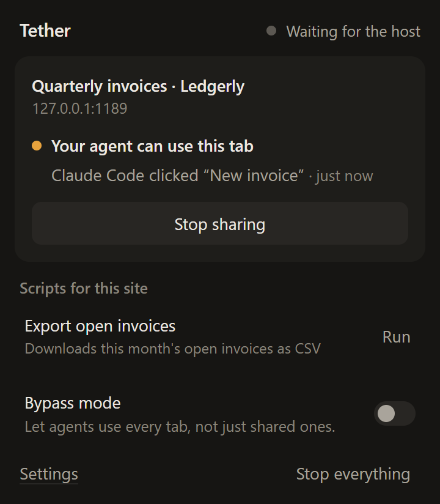

# Tether

Tether lets Claude Code, Codex or any other MCP client work in the browser you already use, signed in as you, on the tabs you hand it. Click the toolbar button on a tab, choose **Share this tab**, and your agent can read the page, fill forms, click through flows, watch network traffic and save small scripts you can rerun later.

It works in Chrome, Brave, Edge and other Chromium browsers, and in Firefox. Several browsers and several agents can be connected at once.

<p>
  
  
</p>

## How it works

```
Claude Code ─┐                               ┌─ Chrome extension ── shared tabs
Codex ───────┼─ tether (stdio) ─ HTTP ─ host ┤
other MCP ───┘          127.0.0.1:47821      └─ Firefox extension ── shared tabs
```

Each agent launches `tether` as an ordinary stdio MCP server. The first one starts a small host process in the background, and every later one connects to the same host, so all agents see the same browsers. The extension connects to the host over a local WebSocket while at least one tab is shared, and drops the connection when you stop sharing. The host quits by itself after 30 minutes with nothing connected.

Nothing happens on a tab you haven't shared. The agent can't list it, read it or touch it. A shared tab gets an amber badge on the toolbar button and a small pill in the corner of the page that names the agent, shows its latest action and has a Stop button.


Tabs join the session in three ways:

1. You click **Share this tab**.
2. A shared page opens a new tab or window (a `target="_blank"` link, `window.open`). Tabs you open yourself with Ctrl+T don't count.
3. The agent opens one with `open_tab`.

## Setup

You need Node 20 or newer.

```sh
git clone https://github.com/udaysinh-git/tether.git
cd tether
npm install
npm run build
node host/cli.js setup
```

`setup` prints the exact lines for your machine, including the pairing key. On this machine they look like:

```sh
# Claude Code
claude mcp add --scope user tether -- "C:\Program Files\nodejs\node.exe" E:\Projects\tether\host\cli.js
```

```toml
# Codex: ~/.codex/config.toml
[mcp_servers.tether]
command = "C:\\Program Files\\nodejs\\node.exe"
args = ["E:\\Projects\\tether\\host\\cli.js"]
```

Any other MCP client takes the same command as a stdio server.

### Chrome, Brave, Edge

1. Open `chrome://extensions` (or `brave://extensions`, `edge://extensions`) and turn on Developer mode.
2. Click **Load unpacked** and choose `dist/chrome`.
3. Pin Tether to the toolbar, click it, and paste the pairing key.
4. Optional: on the extension's Details page, turn on **Allow user scripts** so scripts marked `auto` run on every visit.

### Firefox

1. Open `about:debugging#/runtime/this-firefox`, click **Load Temporary Add-on** and pick `dist/firefox/manifest.json`.
2. Click Tether in the toolbar and paste the pairing key. The first time you share a tab, Firefox asks for access to all sites; allow it.
3. Optional: in Tether's settings, click **Allow user scripts**.

Temporary add-ons are removed when Firefox closes. To keep it installed, sign it as an unlisted add-on with `npx web-ext sign -s dist/firefox --channel unlisted` (needs an addons.mozilla.org API key), or use Firefox Developer Edition with `xpinstall.signatures.required` set to `false`.

## What the agent can do

| Tool | What it does |
| --- | --- |
| `list_tabs` | Lists the tabs it may use, with handles like `chrome:812` |
| `snapshot` | Reads the page as an outline of headings, text and controls, each control with a ref like `[e14]` |
| `read_text` | Plain visible text of the page or one element |
| `click`, `hover` | Clicks or hovers an element by ref |
| `type`, `fill_form`, `select_option` | Types into fields, fills several at once (text, checkboxes, radios, selects) |
| `press_key`, `scroll`, `wait_for` | Keys like `Enter` or `Control+a`, scrolling, waiting for text to appear or go away |
| `upload_file` | Attaches files from disk to a file input, including hidden ones |
| `navigate`, `open_tab`, `close_tab` | Moves around and manages tabs |
| `screenshot` | Image of the visible part of a tab |
| `run_js` | Runs JavaScript in the page's own context and returns the result |
| `network_requests`, `network_request` | The network log since the tab was shared, then full headers and bodies for one request |
| `console_messages` | Console output and uncaught errors |
| `cookies` | Cookies for the current page, including httpOnly ones |
| `save_script`, `run_script`, `list_scripts`, `delete_script` | Reusable scripts that appear in the popup on matching sites |
| `request_bypass` | Asks you for access to every tab (see below) |

Every action returns a fresh snapshot, so the agent rarely needs a second call to see what changed.

## Bypass mode

By default the agent only gets shared tabs. When a task needs more, for example comparing prices across tabs you already have open, the agent calls `request_bypass` with a reason. A small window opens in the browser with the agent's name and that reason, and nothing changes until you click **Allow**.


You can also flip the switch in the popup yourself. While bypass is on, `list_tabs` shows every tab, and any tab the agent touches gets the badge and pill like a shared one. Bypass turns off when you switch it off, click **Stop everything**, or close the browser.

## Scripts

When you ask for something you'll repeat ("make me a script that fills this timesheet with my usual hours"), the agent can save it with `save_script`. Scripts are plain files in `~/.tether/scripts`, shared by all your browsers:

```js
// ==Tether==
// @name        Fill timesheet
// @description Fills this week with 9:30 to 18:00
// @match       https://erp.example.com/timesheet*
// @run         manual
// ==/Tether==
document.querySelectorAll("input.start").forEach((el) => (el.value = "09:30"));
document.querySelectorAll("input.end").forEach((el) => (el.value = "18:00"));
"filled";
```

`manual` scripts show up in the popup on matching pages with a **Run** button. `auto` scripts run on every matching page load once user scripts are allowed (see Setup). Edit or delete the files directly and every connected browser picks up the change.

## Permissions, and why

The extension asks for broad permissions so pages can't stop the agent from doing what you asked. They only apply to tabs you've shared, or every tab while bypass is on.

| Permission | Used for |
| --- | --- |
| Access to all sites | Reading and acting on whatever site you share |
| `debugger` (Chromium) | Clicks and keystrokes the page can't tell apart from yours, `run_js` past strict Content Security Policies, network capture with response bodies, console capture |
| `webRequest` | Network log; in Firefox also response bodies for fetch/XHR, and removing CSP headers on shared tabs so `run_js` works there |
| `scripting`, `userScripts` | The page outline and actions; saved scripts |
| `cookies` | The `cookies` tool |
| `tabs`, `webNavigation`, `storage` | Tracking shared tabs and the tabs they open |

While the debugger is attached, Chromium shows a "Tether started debugging this browser" bar. That bar is the browser's own notice and the extension can't hide it. If you click Cancel on it, Tether stops using the debugger for that tab and falls back to ordinary DOM events. You can also turn it off for good under **Real input** in Tether's settings.

Firefox has no debugger API, so there clicks and typing are DOM events. Most sites accept them; a few that check `event.isTrusted` won't. For `run_js` on a strict-CSP page in Firefox, reload the tab once after sharing it.

## What sites can see

Tether keeps a small footprint in the page. The pill lives in a closed shadow root, the outline code runs in the extension's isolated world, and nothing is added to the page's own JavaScript globals unless you or the agent run a script there. With real input on, clicks and keys look the same to the page as yours.

Tether doesn't spoof fingerprints or try to defeat bot detection. Agent-paced browsing can still look automated to sites that watch behaviour, and some sites' terms forbid automation. That's between you and the site.

## Security

- The host listens on `127.0.0.1` only. It refuses HTTP requests that carry an `Origin` header or the wrong `Host`, so web pages can't reach it, even through DNS rebinding.
- Agents and the extension both need the pairing key in `~/.tether/config.json`. `tether key --new` makes a new one; paste it into the extension again afterwards.
- The host only accepts WebSocket connections from browser-extension origins, and the extension never takes commands from web pages.
- Anyone who can run programs as your user can read the key and drive shared tabs. Treat sharing a tab like handing someone your mouse.

Agents are told to ask before paying, sending messages or deleting things, but that's an instruction to the model, not something Tether enforces. Watch the pill when it matters.

## Commands

```sh
node host/cli.js            # stdio MCP server (what agents run)
node host/cli.js serve      # host in the foreground with logs
node host/cli.js status     # browsers, agents and tab count
node host/cli.js key        # print the pairing key
node host/cli.js key --new  # rotate it
node host/cli.js setup      # config lines for Claude Code and Codex
```

`npm link` puts `tether` on your PATH if you'd rather type that. Host logs go to `~/.tether/host.log` when an agent starts it.

## Development

```
host/        MCP host: cli.js, shim.js (stdio bridge), daemon.js (HTTP + WebSocket), hub.js, tools.js, scripts.js
extension/   background.js, content.js (outline, actions, pill), popup/, options/, prompt/ (bypass window)
scripts/     build-ext.js writes dist/chrome and dist/firefox; make-icons.js draws the icons
test/        e2e.mjs (Chromium + extension + MCP client), shots.mjs (UI screenshots)
```

```sh
npm run build   # after any change in extension/
npm test        # end-to-end, once with the debugger and once without
npm run shots   # screenshots of the popup, pill, prompt and settings into test/shots
```

The end-to-end test loads the built extension into Playwright's Chromium, serves a test page, connects an MCP client through the stdio shim and checks sharing, the outline, form filling, trusted clicks, network and console capture, scripts, bypass and stopping. `--fallback` runs it again without the debugger, which is the same code path Firefox uses. Firefox itself is checked with `npx web-ext lint -s dist/firefox`, not driven end to end.

## Known limits

- Cross-origin iframes show up in the outline as a line you can't read into. Same-origin frames are read and clicked normally.
- Canvas apps (Figma, Google Sheets' grid, games) have little in the outline to act on. Use `screenshot` and `run_js`.
- Network and console logs start when a tab is shared and keep the last 400 entries per tab.
- Screenshots without the debugger, including all Firefox screenshots, bring the tab to the front first.
